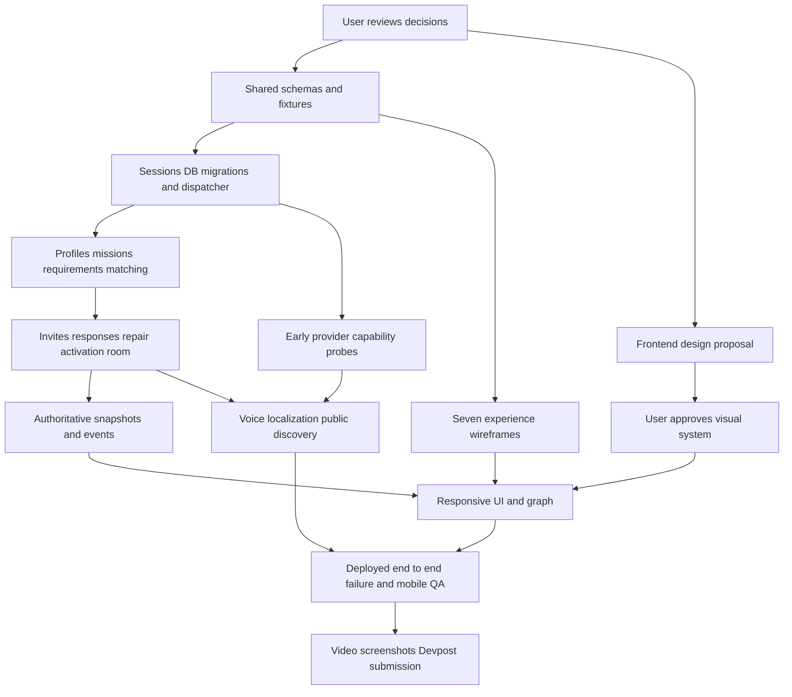

# COHUE engineering readiness report

24 October 2026. Status: planning complete enough for user review; feature implementation NOT authorized and engineering/deployment readiness NOT yet passed. The directory was empty and not a Git repository on arrival. Local Git main has now been initialized for planning continuity. No product application, production dependency lockfile, database, migrations, provider integration, deployed website or active specialist workstream exists.

The full 21-section PRD, including tables, exclusions, competition plan and references, was read through a complete text extraction. An unchanged copy is retained at `docs/reference/COHUE_HackTX_2026_Complete_Master_Plan.docx`; SHA-256 `dbdb2cf77a685be533752e0a40fbdabc6fc434c73517da889a362ba7d7b7dc59`, matching the original Downloads file. `docs/reference/COHUE_Master_Plan.txt` is a convenience extraction, not a replacement authority. Layout was not rendered because this assignment analyzes content and does not edit the DOCX.

## A Product understanding and audit

COHUE turns reviewed multilingual human intent into a persistent, feasible and explicitly agreed collaboration. The proof is a real chain of state changes: profile -> reviewed mission -> deterministic feasible group -> individual invitations -> decline/counter/repair -> valid approvals -> memberships, tasks and Mission Room. Four logical agent roles interpret, discover, optimize and coordinate; they are capabilities of one system. Gemini is not the consent or mathematical authority. External evidence cannot be treated as an enrolled collaborator. The living graph and event trace explain actual work.

All scope is retained. Tier 1 is the non-negotiable complete loop; Tier 2 integrates reasoning/voice/search and truthful motion; Tier 3 may follow without compromising submission. Priority ordering is a dependency order, not permission to ignore design or silently drop required features. No prize outcome can be guaranteed.

| PRD section | Audit and engineering disposition |
| --- | --- |
| 1 Vision | Clear and distinctive; measure coverage, approvals, repairs and activation separately. Do not call advice or search results an outcome. |
| 2 Users/scope | Four roles, three tiers and exclusions preserved. Define operator privileges explicitly; guest role alone cannot become operator. Live/showcase must be isolated. |
| 3 Journeys | Complete central loop. Missing invitation delivery/channel and cross-device identity semantics need resolution. Counterproposal is a revision request, not acceptance. |
| 4 Seven views | All seven retained, including Impact/Replay. Basic truthful persisted replay is distinct from Tier 3 advanced replay controls. Shared theater/room route is viable. |
| 5 Experience | Visual authority remains frontend engineer with user approval. All eight event-bound motions, five viewport bands, reduced motion and non-graph alternatives required. Performance needs a measured dataset/device. |
| 6 Stack | Modular monolith appropriate. Custom orchestration is locked here but initialization requests Mastra validation; recommend custom based on bounded comparison, subject to review. Dependency versions and deployment runtime need install-time audit. |
| 7 Agents | Clear permissions but `recordConsent` cannot be an autonomous model action. Mission DECLINED conflicts with per-invitation declines; normalize via proposal below. Must specify durable wake-up in addition to storage. |
| 8 Matching | Determinism feasible for ~30 profiles with bounded combinatorics. Missing taxonomy, weights, overlap duration, capacity, creator counting and cycle semantics. Return search exhaustion separately from proven no-solution. |
| 9 Voice | Correctly separates translation and TTS. English/Spanish/French required; original/translated terms and explicit UI confirmation protect meaning. Media limits/TTL need account/runtime validation. |
| 10 Search | Tight budget and attribution appropriate. Actual credits unknown. Resource evidence may change next steps, never bypass required human capabilities. Treat retrieved text as untrusted. |
| 11 Data | All 14 named entities retained. Add technical session/job/idempotency/outbox records, proposal member snapshots, consent hashes and uniqueness constraints. Retention/deletion unspecified. |
| 12 API | Good boundary outline. Add mission correction, proposal selection, token redemption, task mutation, retry/cancel and authorized graph snapshots. Missing error/idempotency/version contract now proposed in CONTRACTS. |
| 13 Deployment | Vercel plus Tiger Data appropriate if bounded jobs and scheduler proven. SSE/function lifetime and audio upload limits need deployed checks. Vultr stays conditional until dispatch choice is verified. |
| 14 Testing | Strong definition of done. Add concurrency, stale consent, stream redaction, restart/lease, replay isolation and token-link-preview cases. No app test has run. |
| 15 Competition | Treat times, prizes, source-origin rules and Discord eligibility claims as PRD-provided, not freshly confirmed facts. Devpost fetch failed in research; organizer site provided no readable schedule. User/organizer confirmation still needed. |
| 16 Phases | Keep milestones but start design/contract work early in parallel. Prove core loop and deployed second-device consent before optional infrastructure. |
| 17 Pitch | Three-minute evidence sequence retained. Record an actual deployed run, distinguish synthetic scenario metrics, reserve protected video window. |
| 18 Risks | Existing mitigations retained; add auth/race/wake-up and consent terms invalidation risks. See register below. |
| 19 Resources | Keys/model IDs/quotas, DB, GitHub/Vercel/Devpost, synthetic fixtures and consented audio not provisioned or verified in this workspace. Do not infer secured domain is configured. |
| 20 Handoff | Frontend owns visual expression; lead owns shared contracts; backend owns authoritative domain. Exact file boundaries in WORKSTREAMS. |
| 21 Sign-off | Product remains locked; only explicit proposed clarifications and decisions below await review. No new aesthetic choices or scope reductions made. |

### Decisions needing review

| ID | Ambiguity or contradiction | Recommended resolution | Consequence if unresolved |
| --- | --- | --- | --- |
| D1 | PRD custom state machine vs initialization Mastra preference | Retain custom; Mastra viable fallback after actual DB/runner gate | Two independent sources of lifecycle truth |
| D2 | Mission DECLINED vs some invitees accepting | Keep DECLINED on invitation/event, mission enters REPLANNING | Accepted commitments unnecessarily discarded |
| D3 | Guest sessions and authenticated invitation on second device | Explicit opaque-token redemption to invite-scoped session; possession authorizes that invitation only; disclose bearer-link limitation | Token sharing can masquerade as stronger identity |
| D4 | Whether earlier acceptance survives group changes | Retain only unchanged terms and still-valid hard constraints; changed schedule/role/material group terms require renewed consent | Approval applied to terms never agreed |
| D5 | Availability and optimization are underdefined | UTC intervals plus source timezone, required overlap, distinct coverage, explicit team-size/creator participation, stable lexicographic ranking; review defaults | Feasibility cannot be tested consistently |
| D6 | “Reciprocal cycles” and semantic discovery lack implementation definition | Normalized confirmed taxonomy plus synonym retrieval; direct/complementary/cycle outputs with bounded cycle length 3 initially | Unsupported matching claims or unbounded search |
| D7 | DB runner has no specified wake-up | Prove scheduled dispatcher/account limits; use verified Vultr worker only if necessary; no unattended durability claim from polling | Queued missions stall after request/browser exits |
| D8 | Notification channel unspecified | In-app participant inbox, creator shareable link/QR; persist “ready” status. External outreach deferred unless explicitly authorized | UI claims delivery that never occurred |
| D9 | Post-activation withdrawal/capacity | Initial version surfaces changes for explicit review; do not silently dissolve or overbook teams; decide cross-mission capacity model | Stale commitments and double booking |
| D10 | Personal data/audio deletion | Proposed raw audio removed after transcription, synthesized TTL 24h, opt-out removes public/discovery projection, explicit data deletion policy before public use | Unexpected retained private information |
| D11 | Synthetic baseline says 20 versus ~30 people | Use 30 labeled fixtures with a 20-person matcher regression subset | Inconsistent tests; not a scope conflict |
| D12 | Three-language requirement vs optional multilingual tier | Core text consent first, then all three languages validated for final DoD; tiering does not erase language requirement | False completion claim |

Final design approval remains separately required: frontend engineer must present actual font/color/component choices before full implementation. This report has deliberately not chosen them. No permission is needed merely to accept this report; implementation awaits the review gate explicitly requested in the initialization.

## B Architecture and technology disposition

Proposed architecture: one Next.js 16 App Router TypeScript application; server-only modular services over Tiger Data PostgreSQL via Drizzle. Browser uses TanStack Query for server snapshots/cache, Zustand for ephemeral UI, React Flow plus ELK for graph layout and Motion for truthful transitions. Zod is the shared validation authority. Radix/selective shadcn supply primitives after design review. Gemini, ElevenLabs and SerpApi are adapters, never directly imported into client modules. Vitest covers domain/contract behavior; Playwright covers mobile and desktop collaboration journeys.

Domain commands -> authorized transactional services -> state/events/jobs/outbox -> bounded runner -> validated agent/provider results -> version-checked transaction -> SSE/polling projection. Provider calls occur outside database locks. Persist a checkpoint at each bounded step. Activation locks current mission/proposal, verifies terms, requirements and approvals, and commits memberships/tasks/event once. Consent, rejection and constraint changes invalidate affected snapshots. No microservices, Redis, Kafka, Kubernetes or heavy rendering engine is justified now.

Retain all approved baseline technologies. Recommend custom orchestration; Mastra remains evaluated/deferred, Trigger.dev deferred, Vultr conditional. Reject wholesale reuse of the three reference applications. No Solana/Snowflake addition without meaningful product need and approved scope. See OPEN_SOURCE_ADOPTION for licenses/current metadata and ORCHESTRATION_EVALUATION for measured versus untested behavior.

Planned repository boundaries (only docs/research and continuity files currently exist):

```text
src/app/                         frontend pages; api/**/route.ts backend
src/contracts/                   lead-owned Zod/domain/DTO/event schemas
src/components/{network,theater,voice,missions}/
src/features/{participants,missions,invitations,collaboration}/
src/client/{state,queries,events}/
src/server/domain/{participants,missions,matching,invitations,collaboration}/
src/server/{agents,orchestration,tools,providers,database,auth}/
drizzle/                         backend schema migrations
tests/{unit,integration,e2e}/     ownership follows tested boundary
scripts/worker/                  optional runner entry and operations
docs/                            reviewed specifications and evidence
```

Use small function/module boundaries, not packages/services for each agent. Shared business functions do not import React, network SDKs or provider prompts. Server persistence enforces constraints even if the client bypasses its own UI. Public graph is a redacted projection; raw participants/events cannot simply be exposed for animation.

## C Open source findings and experiment

The six-repository adoption matrix, license URLs, estimated costs, module effects and risks are in OPEN_SOURCE_ADOPTION.md. Source review found MIT React Flow/OpenFlowKit/Dashboard Design, AGPL MiroFish, Apache Trigger.dev, and Mastra's Apache non-ee core plus separately licensed ee paths. ELK has additional EPL handling. No reference application was cloned or copied.

The isolated local experiment verified Mastra persisted suspension and resumed across processes; false approval stayed suspended. A minimal custom conditional-update sample persisted state and repeated activation did not increment twice. Exact results and limitations are in ORCHESTRATION_EVALUATION. This is not a typechecked TypeScript or Tiger Data proof. Both still need actual consent authorization, distributed races and deployed wake-up tests. Recommendation derives from lower integration/state-model complexity for COHUE, not an unsupported performance claim.

## D Ownership

Lead owns contracts, architecture, integration, release and synchronized handoffs. Frontend owns the seven experiences, design proposals, responsive layouts, graph, accessibility and motion. Backend owns auth, state machine, matcher, database, API, agents, providers and runner. File-level boundaries, initial deliverables and acceptance criteria are in WORKSTREAMS.md. Root dependency/config changes flow through lead; no concurrent edits to shared contracts without an agreed revision. Specialists are prepared but inactive.

## E Integration strategy

CONTRACTS.md defines v0.1 domain DTOs, agent inputs/outputs, lifecycle clarification, idempotency, scoped auth, error envelope, API operations, versioned consent, redacted event schema, graph projection, snapshot/sequence synchronization, transactions and runner leases. It is a specification, not implemented code. Before implementation, lead translates approved contracts into one shared Zod source and fixture set consumed by both workstreams. No duplicate independently defined event types or mission states.

Tests must distinguish event delivery duplication from domain effect duplication. At-least-once jobs and event delivery are expected; domain receipts/unique keys/fencing prevent repeated invitations and activation. For incomplete search, degraded providers or lost stream connections, show the precise state and allow safe recovery. Replay reads historical events and cannot trigger business commands.

## F Critical implementation roadmap

The PRD says hard submission is Sunday 25 October 2026 11:30 AM CDT and soft checkpoint Saturday 24 October 11:30 PM CDT. These remain unverified competition facts. Use them conservatively for planning until confirmed. Do not extend development based on an unverified later schedule. Research completed around 4:33 PM CDT Saturday; remaining deadline window is under 19 hours, including sleep/recording/submission. Estimates below are elapsed collaborative windows, not promises; rebase after user review.

| Gate | Dependency | Required evidence | Suggested allocation |
| --- | --- | --- | --- |
| 0 Review and decisions | This report | approve build phase, resolve D1–D8, confirm build rules/deadline/account readiness | first 15–30 min after review |
| 1 Contracts/design/infrastructure | Gate 0 | shared schemas/fixtures; design proposal early; DB migration; preview deploy; provider capability probes; chosen durable dispatch | first 60–90 min; frontend proposal parallel |
| 2 Core formation | Gate 1 | real mobile onboarding, corrected mission, 30-person fixture, constraints and feasible group; matcher unit/integration tests | next ~2 h |
| 3 Consent and repair | Gate 2 | second-device response; decline preserves valid approval; recomputed feasible replacement; race-safe activation and Mission Room/tasks | next ~2–3 h; target before soft checkpoint |
| 4 Truthful theater | approved design + events from 2–3 | seven functional experiences, real execution trace, graph status, reconnect/polling and basic impact/replay | continuous frontend work integrated at each gate |
| 5 Signature integrations | core stable + provider probes | reviewed speech extraction; English/Spanish/French text/audio; sourced SerpApi resource changes recommendation; failures fall back honestly | overnight bounded ~2–3 h |
| 6 Deployed QA/rehearsal | Gates 3–5 | phone join/invite, both modes, no-solution/decline/schedule/translation scenarios; worker restart with browsers closed; responsive/accessibility/reduced motion | protected 1.5–2 h |
| 7 Record and submit | working verified build | real three-minute flow, backup recording, screenshots, README/provider evidence/track eligibility, accessible source/demo links and Devpost confirmation | freeze by ~8:30 AM, record by ~9:30, target submit ~10:30 AM CDT |

These cutoffs are proposed safety margins relative to the supplied deadline. If behind, defer Tier 3 only, retain clear incomplete status for any missed Tier 1/2 gate and discuss any scope reduction with the user. No late infrastructure experiment or decorative effect may consume the protected video/submission window. Do not claim final DoD if mandatory voice/search/mobile tests are missing.

Dependency graph:



## G Risks and blockers

| Risk/blocker | Severity | Mitigation and readiness proof | Owner |
| --- | --- | --- | --- |
| No DB/keys/account quotas/deployment yet verified | Critical | redacted capability probes, actual migration and phone deployment before dependent work | Backend/lead |
| Consent stale/raced or token used by wrong principal | Critical | explicit scoped identity model, terms hash, revision checks, CSRF, transactional race tests | Backend |
| Runner stops after serverless request | Critical | prove dispatcher + lease/checkpoint recovery with clients closed; choose worker only if needed | Backend/lead |
| Too much scope for remaining event window | Critical | enforce gates, continuous integration, early recording, no silent scope cuts | Lead/user |
| User visual approval arrives late | High | early concrete design board while domain work proceeds; no full frontend before approval | Frontend/user |
| Missing replacement/common availability | High | seeded labeled scenario plus real live inputs; hard constraints and paused-human path; no fabricated success | Backend |
| Multilingual normalization/translation changes terms | High | source text, review, canonical hash; localize without mutating commitments; test three languages | Both |
| Public graph or event stream leaks profiles/tokens | High | per-principal projections and auth tests including reconnect/replay | Backend/frontend |
| Audio request too large/function timeout | High | validate deployed platform limits, short recording cap, stream/private upload path if needed, typed fallback | Both |
| Search exhausts credits or public result is mistaken for agreement | Medium/high | bounded search/cache/budget, source attribution and distinct node kinds | Backend/frontend |
| ELK/reference license obligations overlooked | Medium | source/license ledger and shipped component notices; no MiroFish code use | Lead |
| Few participants or unreliable venue network | High | isolated labeled showcase uses same engine/state machine; real second-device rehearsal | Lead |
| Rules/award limits not independently confirmed | High | organizer/Devpost verification before submission; preserve supplied Discord claims as unverified evidence | User/lead |

Not checked: private accounts, secret values, provider model availability, balances, domain DNS, hosting runtime/cron plan, Tiger Data extensions, organizer Discord extracts or ceremony deck contents. No email/Slack/contact outreach was attempted. No cloud resource was created or published. No final design selected. No production test or security scan was run because no application tree exists.

## H Durable artifacts and verification

Created repository-root AGENTS.md, CODEX_HANDOFF.md, CLAUDE_HANDOFF.md and lightweight CLAUDE.md. The two handoffs carry identical substantive content and explicit status, source, ownership, contracts, provider/DB/deployment state, tests and next actions. Repository-relative links above are navigation; absolute paths are listed in root handoffs and final response.

Local verification: complete PRD extraction read; copied source checksum matches original; six repository metadata/license checks and current package metadata retained; eight orchestration research process invocations/assertions passed. No feature scaffold exists. Before final delivery, check both handoffs match, local links/files exist, no node_modules or DB is tracked and Git diff has no whitespace errors. Production unit/integration/E2E tests remain planned.

## I Exact next action

User reviews this report and the decision table, particularly custom orchestration, invitation identity/consent preservation and dispatcher choice. After explicit authorization to build, activate the two prepared workstreams: frontend first delivers a concrete design-system proposal for user approval; backend proves account-backed DB/provider/dispatcher readiness against approved shared contracts. Lead first turns approved contract v0.1 into shared schemas/fixtures and a minimal common scaffold. Do not begin these actions during this initialization turn.

## Research sources

Primary links are embedded in OPEN_SOURCE_ADOPTION and ORCHESTRATION_EVALUATION. Additional integration evidence: [Gemini structured output](https://ai.google.dev/gemini-api/docs/structured-output) supports a subset of JSON Schema and still needs semantic validation; [ElevenLabs transcription](https://elevenlabs.io/docs/overview/capabilities/speech-to-text) and [TTS](https://elevenlabs.io/docs/speech-synthesis/voice-settings) describe separate capabilities; [SerpApi search](https://serpapi.com/search-api) provides attributed search data; [Vercel function limits](https://vercel.com/docs/functions/limitations) require deployed duration/upload validation. Account-specific access and limits are unverified. [HackTX Devpost](https://hacktx26.devpost.com/) was inaccessible through the research browser and [organizer site](https://hacktx.com/) returned no readable schedule. The supplied PRD, not those fetches, is the origin of the stated event times and prize rules.
